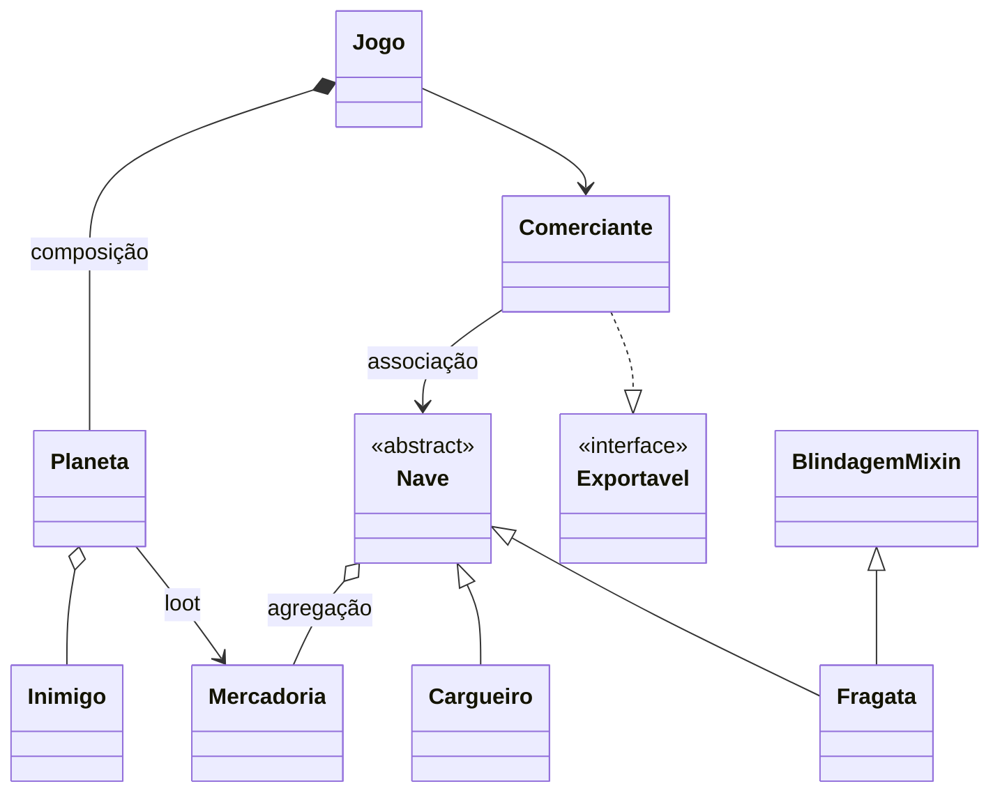

# Mercante Espacial
 
Jogo de aventura e comércio espacial no terminal, feito em Python para a disciplina de Programação Orientada a Objetos.
 
O jogador escolhe uma nave, enfrenta inimigos em batalhas por turno, vende o loot para comprar melhorias e precisa derrotar o chefão do planeta final para vencer.
 
**Equipe:** Derick, Guilherme, Gustavo e Marcus.
 
## Como executar
 
Requisitos: Python 3, apenas biblioteca padrão (`abc`, `random`, `pickle`, `csv`).
 
```bash
python -m venv venv
 
# Windows
venv\Scripts\activate
# Linux / macOS
source venv/bin/activate
 
python main.py
```
 
## Como jogar
 
1. Informe seu nome, escolha a nave e comece um novo jogo (ou carregue o `save.pkl`).
2. No mapa, escolha um planeta. Quanto maior o risco, melhores os itens e mais fortes os inimigos.
3. Enfrente os inimigos do planeta, um de cada vez, em batalhas por turno.
4. Ao conquistar o planeta, o loot vai para o porão da nave e você entra no comércio: venda itens, compre melhorias e repare a nave.
5. Volte ao mapa e escolha o próximo planeta.
6. Depois de conquistar 3 planetas, o planeta final é liberado. Derrotar o chefão encerra o jogo com vitória.
## Regras
 
**Início:** 100 créditos, nave com 100 de vida e 15 de ataque, porão vazio.
 
**Naves**
 
| Nave | Porão | Extra |
|---|---|---|
| Cargueiro | 30 unidades | Maior capacidade de carga |
| Fragata | 20 unidades | Blindagem: recebe metade do dano |
 
**Planetas**
 
| Planeta | Risco | Inimigos | Loot |
|---|---|---|---|
| Terra Nova | baixo | Drone Sucateiro, Saqueador Novato | 4 Sucata, 1 Cristal Bruto |
| Ferrum | médio | Pirata Espacial, Caçador de Recompensas | 3 Cristal Bruto, 1 Liga Estelar |
| Aridia | médio | Mineradora Rebelde, Predador das Dunas | 2 Cristal Bruto, 2 Liga Estelar |
| Nexus | alto | Caçador de Elite, Fragata Sombria, Guardião Antigo | 3 Liga Estelar, 2 Núcleo de Plasma |
| Coração do Vazio | final | Sentinela do Vazio, Senhor do Vazio (chefão) | sem loot |
 
**Itens e valor de venda:** Sucata 10, Cristal Bruto 35, Liga Estelar 90, Núcleo de Plasma 200.
 
**Batalha**
- Ações do turno: **Atacar** ou **Defender**.
- O dano de cada golpe varia 20% para mais ou para menos.
- Se o ataque derrota o inimigo, ele não contra-ataca naquele turno.
- Defender corta pela metade o dano recebido (na Fragata, a blindagem corta de novo).
- A vida **não** se recupera entre os inimigos do mesmo planeta; só o reparo no comércio recupera.
- O loot que não couber no porão é descartado.
- Não é possível salvar durante uma batalha.
**Comércio**
- Vender itens pelo valor fixo de cada um.
- Reparar a nave: 2 créditos por ponto de vida.
- Melhorias, com preço de `custo base × (nível + 1)`:
| Melhoria | Efeito por compra | Custo base |
|---|---|---|
| Ataque | +5 de ataque | 100 |
| Casco | +20 de vida máxima | 80 |
| Carga | +5 de capacidade do porão | 60 |
 
**Fim de jogo**
- **Vitória:** derrotar o Senhor do Vazio no Coração do Vazio.
- **Derrota:** a vida da nave chega a zero.
## Estrutura do projeto
 
```
mercante_espacial/
├── venv/
├── main.py           menus, input/print, try/except
├── jogo.py           Jogo
├── comerciante.py    Exportavel, Comerciante
├── naves.py          Nave, BlindagemMixin, Cargueiro, Fragata
├── mundo.py          Mercadoria, Inimigo, Planeta
├── testes.py         testes automáticos de todos os módulos
└── README.md
```
 
Arquivos gerados durante o jogo: `save.pkl` (jogo salvo), `historico.csv` e `historico.txt` (exportação do histórico).
 
## Classes
 
| Arquivo | Classe | Tipo | Responsabilidade |
|---|---|---|---|
| `mundo.py` | `Mercadoria` | Concreta | Item de loot com nome e valor de venda |
| `mundo.py` | `Inimigo` | Concreta | Adversário com vida e ataque; recebe dano |
| `mundo.py` | `Planeta` | Concreta | Risco, inimigos e loot de cada destino |
| `naves.py` | `Nave` | Abstrata | Vida, ataque, porão e melhorias |
| `naves.py` | `BlindagemMixin` | Mixin | Reduz o dano recebido pela metade |
| `naves.py` | `Cargueiro` | Filha de `Nave` | Porão de 30 unidades |
| `naves.py` | `Fragata` | Filha de `BlindagemMixin` e `Nave` | Porão de 20 unidades, com blindagem |
| `comerciante.py` | `Exportavel` | Interface | Contrato `to_csv` e `to_txt` |
| `comerciante.py` | `Comerciante` | Concreta | Créditos, nave, venda, melhorias, reparo e histórico |
| `jogo.py` | `Jogo` | Concreta | Planetas, batalha por turno, fim de jogo, salvar e carregar |
 
### Relacionamentos
 

 
## Conceitos de POO aplicados
 
| Aula | Conceito | Onde aparece |
|---|---|---|
| 1 | Ambiente virtual e `__main__` | `main.py` roda dentro de `if __name__ == "__main__":`; todos os arquivos têm um teste rápido no mesmo bloco |
| 2 | Classe, atributo, método, exceção | Todas as classes; erros com `raise Exception("mensagem")` |
| 3 | Encapsulamento, herança, `pickle` | Atributos privados com getters; `Cargueiro(Nave)`; `Jogo.salvar()` e `Jogo.carregar()` |
| 4 | Associação | `Comerciante` usa uma `Nave` |
| 4 | Composição | `Jogo` cria os `Planeta`s no construtor |
| 4 | Agregação | `Nave` recebe `Mercadoria`s no porão ao longo do jogo |
| 5 | Classe abstrata | `Nave` |
| 6 | Interface | `Exportavel`, realizada por `Comerciante` |
| 7 | Mixin e herança múltipla | `Fragata(BlindagemMixin, Nave)` |
 
## Persistência e exportação
 
- `Jogo.salvar()` grava o jogo inteiro em `save.pkl` com `pickle`; `Jogo.carregar()` o recupera.
- `Comerciante.to_csv()` e `to_txt()` exportam o histórico de coletas, vendas, melhorias e reparos.
## Convenções de código
 
- Classes em `PascalCase`; métodos com verbo em `snake_case`.
- Toda classe tem `__str__()`.
- Erros usam `raise Exception("mensagem")` e são tratados no `main.py`.
- Só o `main.py` usa `print` e `input`; as demais classes devolvem valores ou textos.
- Cada arquivo tem um teste rápido em `if __name__ == "__main__":`.
## Testes
 
O arquivo `testes.py` testa todos os módulos com `assert` e mostra `OK` para cada um:
 
```bash
python testes.py
```
 
Cada módulo também tem um teste rápido próprio, com os arquivos na mesma pasta:
 
```bash
python mundo.py
python naves.py
python comerciante.py
python jogo.py
```
 
O teste do `jogo.py` simula uma partida completa: conquista três planetas, libera e vence o final, salva e carrega o jogo e provoca os erros esperados.
 
## Divisão do trabalho
 
| Integrante | Arquivo |
|---|---|
| Guilherme | `mundo.py` |
| Marcus | `naves.py` |
| Gustavo | `comerciante.py` |
| Derick | `jogo.py` |
 
UML, fluxograma, testes finais e README foram feitos por todo o grupo.
 
